[Portfolio](https://jai-agrawal.netlify.app/) · [LinkedIn](https://linkedin.com/in/jaiagrawal2909) · [Email](mailto:jaiagrawal022@gmail.com)

---

## Profile

I'm a software development engineer at Whinta. I work mostly on backend systems, API design, and AI integration.

B.Tech in Computer Science (2026) from United Institute of Technology, Prayagraj.

## What I do

- **Backend development**: APIs, databases, and server-side systems
- **Full stack development**: web applications from the database to the interface
- **AI integration**: bringing AI features into products
- **Cloud**: deploying and running services on AWS

## Tech stack

| Area | Tools |
| --- | --- |
| Languages | Java, JavaScript, Python, HTML, CSS |
| Frameworks | Node.js, Express.js, React, FastAPI |
| Databases | MongoDB, PostgreSQL, MySQL, Redis |
| Cloud | AWS |
| Tools | Git, Postman, VS Code |

**Concepts:** Data Structures & Algorithms, Object-Oriented Programming, REST API design, database management

## Beyond work

- Solved 200+ problems on LeetCode and CodeChef
- Regular hackathon participant
- Photography, with 25K+ views on Pinterest

## Contact

jaiagrawal022@gmail.com · Prayagraj, India
